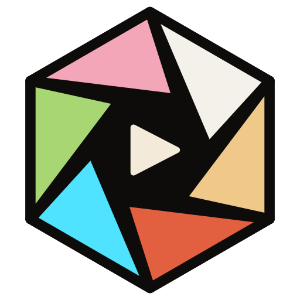

# Kaleido

A video player with VLC's engine and a plain, quiet interface. It plays everything VLC plays.

- Ordinary controls that hide while you watch: seek with frame previews and chapter marks, volume up to 200%, subtitles, audio tracks, speed, full screen.
- Pausing is the one special moment: the room warms up, the picture is held like a photograph (letterbox bars cropped away), and the last few moments you saw sit beside it. Click one to go back there.
- Release-style file names become real titles ("The Long Way North (2024)", not the whole download name).
- Every file remembers where you stopped, and the rest of the folder queues up after it.
- Skip intro during chapters named Intro, Opening or Recap, and an up next card with a countdown near the end.
- Bookmarks (Ctrl+D) shown on the seek bar, double click the left or right side to jump 10 seconds, a queue panel, and a mini player (Ctrl+M).
- Quality badges next to the title (4K, HEVC, 5.1) and six colour themes on the home page, which has moving film doodles.

## Only in Kaleido

Things the big desktop players (VLC, mpv, PotPlayer, IINA, MPC) do not do:

- **What did they say? (W)** jumps back 10 seconds with subtitles on, then turns them off again.
- **Search what they say (/)** finds any line of dialogue in the subtitles and jumps to it.
- **Languages remembered per series.** Choose the audio and subtitle language once and every file in that folder follows.
- **Skip silence** jumps over long quiet stretches in lectures and recordings.
- **Save a clip (C)** keeps the A to B loop, or the last 30 seconds, as a frame accurate mp4 in Videos, Kaleido clips.
- **Pauses when you lock the PC** or it goes to sleep, and tells you when you are back.

Two other interfaces are still in the project as alternatives (Ctrl+Tab): The room and Prose.

The logo is a lens iris that is also a kaleidoscope: six blades, one for each colour theme, opening onto a play mark. `assets/logo.svg` is the source; `npm run icons` rebuilds `assets/icon.ico` and the PNGs from it.

## How it works

- `engine/` is a small Rust program that loads libVLC from `vendor/vlc`, receives decoded frames through VLC's video callbacks and streams them, along with the player state, over a local WebSocket. Playback, codecs, subtitles, the equalizer and filters are all VLC.
- `main.js` is the Electron main process. It starts the engine, restarts it if a VLC module crashes, and handles files, windows and saved state.
- `src/core/` draws frames with WebGL and keeps the player state (`engine.js`), and holds the shared shell (keyboard, drag and drop, idle hiding).
- `src/skins/normal/` is the default interface; `src/skins/room/` and `src/skins/prose/` are the alternatives.

ffmpeg is optional and only used for frame previews, the colour line at the end, and posters.

## Download

Windows 10 and 11, 64-bit: get the installer or the portable version from the [releases page](https://github.com/Primnox/kaleido/releases/latest), or visit [primnox.github.io/kaleido](https://primnox.github.io/kaleido/). Both carry VLC and FFmpeg inside, so nothing else needs installing. The installer is not code signed yet, so Windows SmartScreen may ask you to choose More info, then Run anyway.

## Build the installers

```
npm run dist
```

`scripts/stage.js` gathers the engine, a trimmed VLC (with a fresh plugin cache) and FFmpeg into `staging/`, then electron-builder writes `dist/Kaleido-Setup-<version>.exe` and `dist/Kaleido-<version>-Portable.exe`. The website lives in `site/`; `node scripts/build-site.js` refreshes the logo and doodles it shares with the app.

## Run it from source

```
npm install
npm run setup
npm start
```

`npm run setup` downloads VLC 3.0.24 from videolan.org (checksum verified) into `vendor/vlc` and builds the Rust engine. It needs the Rust toolchain with the MSVC target.
